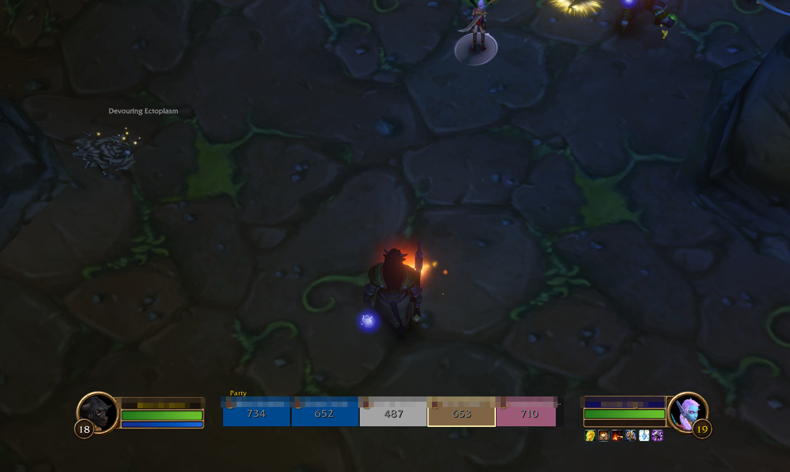
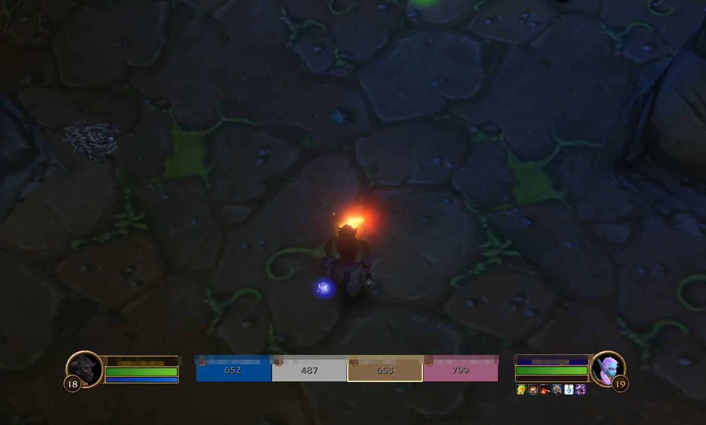

# GroupSelfHide

WoW addon (WoW Forever) that hides **your own frame** in raid-style party frames.

## Features

- Hides your own frame and the "Party" label
- Mode `fill` (`/gsh`): also widen the other frames to keep the group width (2-5 players)
- Mode `hide` (`/gsh hide`): only hide your frame, the gap stays
- Calling a command while a mode is active switches back to normal
- Choice persists across sessions (default: off)
- Applies out of combat only

## Screenshots

Before (own frame shown) and after (`/gsh`):




## Install

Copy this folder to `World of Warcraft/<version>/Interface/AddOns/GroupSelfHide`, then start the game or `/reload`.

## Usage

```text
/gsh        fill mode: hide and widen the others (again: back to normal)
/gsh hide   hide mode: hide only (again: back to normal)
```

Examples:

- `/gsh` closes the gap; the other four frames grow to the old total width.
- `/gsh hide` only hides your frame.
- Call either command again to show your frame.
