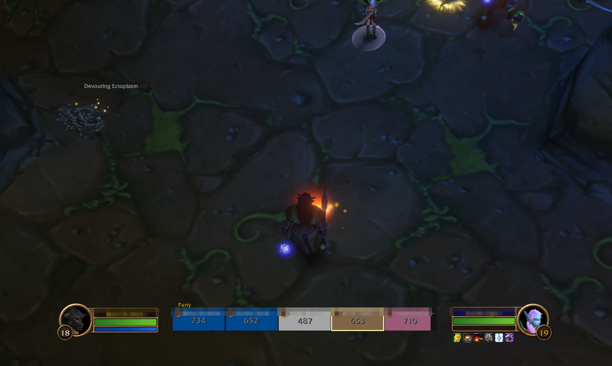
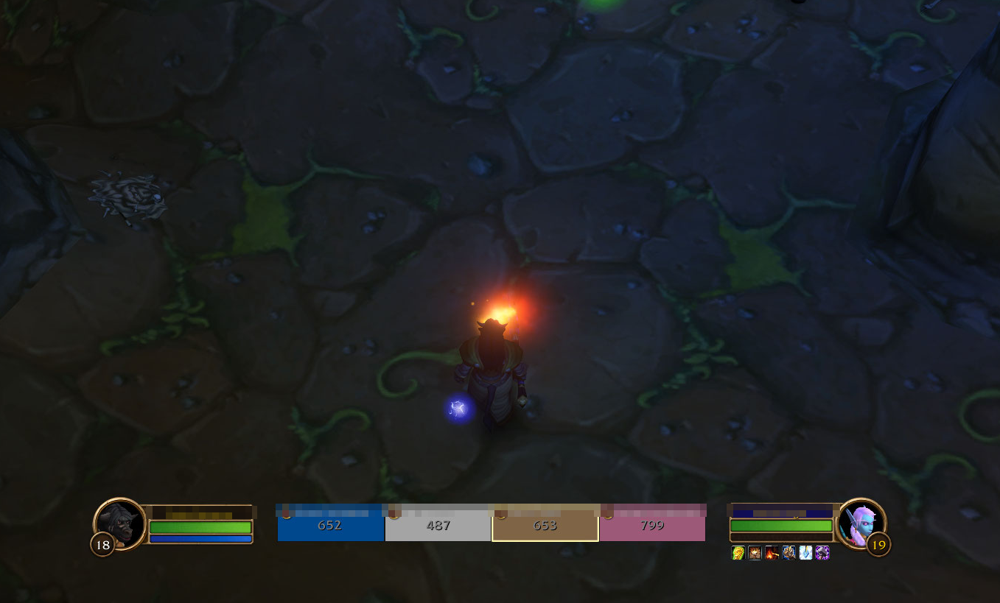

# GroupSelfHide

Hides your own frame in raid-style party frames.

## Features

- **Hide mode** - hides your own frame and the "Party" label; the gap stays.
- **Fill mode** - also widens the other frames so the group keeps its width (2-5 players).
- **Scope guard** - inactive in raids and with a vertical party layout; changes apply out
  of combat only.
- **Remembered** - settings are saved per account, or per character with one checkbox;
  default is off.
- **Settings page** - all options in the game menu under Options > AddOns, also opened
  from the addon compartment menu.
- **Chat commands** - every option can also be changed by slash command.

## Screenshots

Before (own frame shown) and after (`/gsh fill`):




## Install

1. Download `GroupSelfHide-vX.Y.Z.zip` from the
   [releases](https://github.com/tf4482/GroupSelfHide/releases) (or CurseForge, Wago).
2. Unzip it into `World of Warcraft/_forever_/Interface/AddOns/`.
3. Restart the game or type `/reload`.

## Usage

```text
/gsh                show the current mode
/gsh fill           hide your frame and widen the others
/gsh hide           hide your frame, keep the gap
/gsh off            show your frame again
/gsh character on   use settings for this character only
/gsh character off  use the account settings again
/gsh test           apply the mode once now
/gsh reset          reset the settings to defaults
/gsh debug on       show what the addon does, until /reload
/gsh config         open the settings page
/gsh help           list all commands
```

## Examples

- In a 5-player party, `/gsh fill` closes the gap; the other four frames grow to the old
  total width.
- `/gsh hide` only hides your frame, the other frames keep their size.
- In a raid or with vertical party frames, the mode stays saved but does nothing;
  `/gsh` says so.
- Typed during combat, a mode change applies right after combat.
- `/gsh character on`, then `/gsh off` on a healer keeps the frame there while other
  characters still hide it.

## Develop

Check the code with [Luacheck](https://github.com/lunarmodules/luacheck) before each commit
(CI runs it on every push):

```text
luacheck .
```

Deploy locally: run `deploy.bat`; it builds `release/GroupSelfHide-vX.Y.Z.zip` from `VERSION`.

Release: set `VERSION` to `X.Y.Z`, then push an annotated tag `vX.Y.Z`; GitHub Actions
packages the addon with the BigWigs packager and publishes it.

## License

Copyright (c) 2026 tf4482. All rights reserved, see [LICENSE](LICENSE).

You may download this addon and use it for personal, non-commercial play in your own game client. Without prior written permission, you may not:

- redistribute or re-upload it, in whole or in part, on any site or platform
- modify it or publish modified versions or forks
- bundle it into compilations, addon packs, or other projects
- use it commercially

For permissions, open an issue on GitHub.
